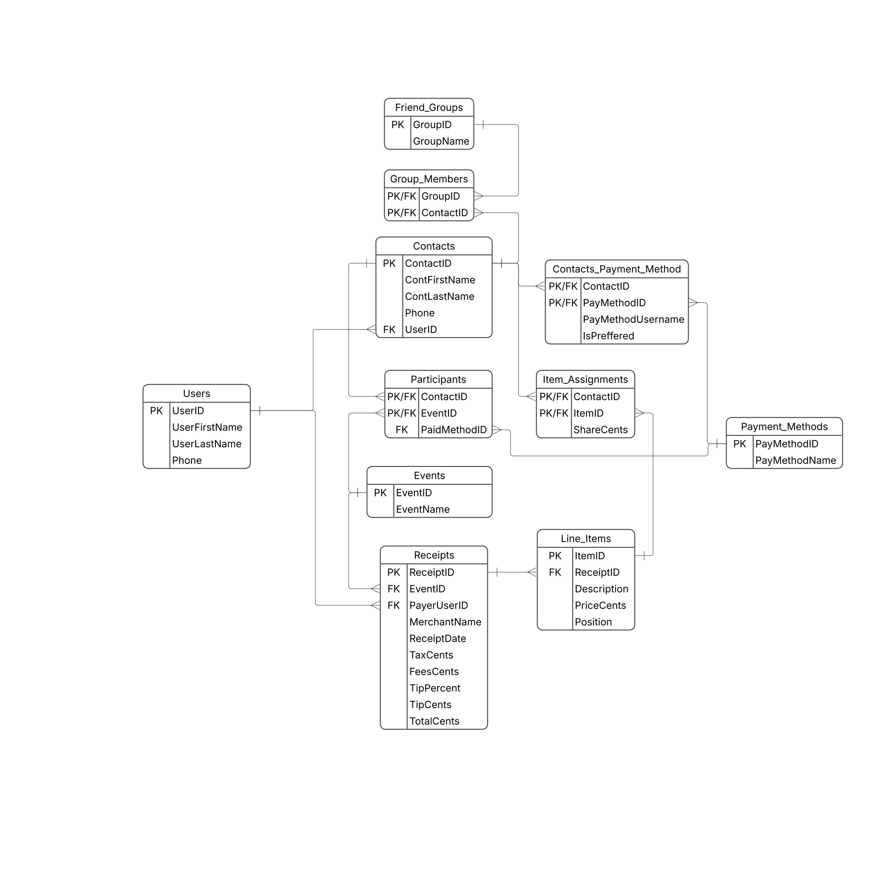

# IOYA

Scan a receipt, match items to friends, and make sure you get paid back.

**Team:** Jackson, Tye, Nick, Tanner

## App Summary

When one person pays a shared restaurant bill, they are left doing math on a receipt, splitting shared appetizers, spreading tax and tip fairly, and then chasing each friend for their share. That process is slow, easy to get wrong, and makes it easy to forget who still owes money. IOYA is for the person who picks up the tab for a group of friends, roommates, or family. The app turns a receipt into line items, lets the payer tap which friend had which item (including shared items), and splits tax, tip, and fees in proportion to what each person ordered. Each outing is saved as an event, so the Home screen's Paid / Unpaid board and the History screen show exactly who has paid you back and how. Saved contacts with their preferred payment method (Venmo, PayPal, Zelle, or cash) and friend groups like "Family" or "Lunch crew" make the next split faster.

## ERD



The original diagram is also in [`docs/ioya-erd.pdf`](docs/ioya-erd.pdf).

**Relationships and cardinality**

| Relationship | Cardinality | Through |
|---|---|---|
| Users → Contacts | one-to-many | `Contacts.UserID` |
| Users → Receipts (as the payer) | one-to-many | `Receipts.PayerUserID` |
| Friend_Groups ↔ Contacts | many-to-many | `Group_Members` |
| Contacts ↔ Payment_Methods | many-to-many | `Contacts_Payment_Method` (stores the username and whether it is preferred) |
| Events → Receipts | one-to-many | `Receipts.EventID` |
| Receipts → Line_Items | one-to-many | `Line_Items.ReceiptID` |
| Contacts ↔ Events | many-to-many | `Participants` |
| Payment_Methods → Participants (how they paid) | one-to-many | `Participants.PaidMethodID`, empty until the person pays |
| Contacts ↔ Line_Items | many-to-many | `Item_Assignments` (stores each person's share in cents) |

**How the diagram becomes tables.** The SQL in [`supabase/schema.sql`](supabase/schema.sql) uses the same 11 tables and columns, written in Postgres's lowercase snake_case style: `Users.UserFirstName` becomes `users.user_first_name`, `Contacts_Payment_Method` becomes `contacts_payment_method`, and so on. `IsPreffered` is spelled `is_preferred` in the database. Money is stored as whole cents, so `1959` means $19.59.

**The payer is also a contact.** Each user has one row in `contacts` with the same name and phone as their `users` row. That lets the payer be a participant and be assigned items like everyone else, and the app shows that contact as "You."

## Tech Stack

| Layer | What we used | Why |
|---|---|---|
| Database + backend | [Supabase](https://supabase.com) (hosted PostgreSQL with an automatic REST API) | Most of our group already knows Supabase, the free tier covers this project, and the Table Editor lets everyone see the data without installing a database. |
| Frontend | Plain HTML, CSS and JavaScript in [`public/index.html`](public/index.html), using the [`supabase-js`](https://supabase.com/docs/reference/javascript) library | Our screens started as one clickable HTML prototype, so we kept it and connected it to Supabase. There is no build step. |
| Web server | Node.js 18+ with Express, in [`server.js`](server.js) | Serves the page and passes it the Supabase URL and key from `.env`, so they are never committed to GitHub. |
| Receipt reader | [Tesseract.js 7.0.0](https://github.com/naptha/tesseract.js), loaded on the first scan | Reads photos in a browser worker without an OCR API key or uploading the photo to a recognition service. Its script, engine and English language data download from public CDNs. |
| Secrets | A git-ignored `.env` file | [`.env.example`](.env.example) shows the format. |

**Security.** The app has no login yet, so it uses Supabase's public **anon** key and always acts as the sample user, Demo Payer. Row Level Security is on for every table. With the anon key, the app can:

- **read** every table;
- **update only `participants.paid_method_id`**, which is the "Mark as paid" button;
- **add, edit and delete contacts** only through two database functions, `save_contact` and `delete_contact` (in [`supabase/contacts-sync.sql`](supabase/contacts-sync.sql)). They check the input and save a contact and its payment methods together in one transaction. A contact who is on a past split can't be deleted, because that would erase their items from the receipt.

Every other change has to be made in the Supabase dashboard. Never put the `service_role` key or the database password in `.env` or in the code.

**Saved to Supabase:** contacts you add, edit or delete on the Contacts screen, and "Mark as paid." Everyone using the same Supabase project sees the same data.

**Receipt scanning:** Start split → Take photo or Upload photo → Check the items. On HTTPS or localhost, Take photo opens a live in-page preview when the browser supports it, after the user grants camera permission. It prefers the rear camera and does not request a microphone. Capture photo takes a still (or a video frame where needed) and reads it locally. The camera stops after capture, on closing, on leaving the capture view and when the tab is hidden/unloaded. On HTTP phone LAN addresses or unsupported browsers, Take photo uses the native camera/file picker instead. That fallback is also available explicitly. Choose a browser-readable image under 20 MB. The first scan needs internet to download the OCR reader. Check every item, tax, fees and printed total before continuing. Photos stay in memory; the editable draft is saved locally. Scanning does not save a receipt to Supabase.

Start split opens the camera directly; Resume current split continues the existing draft. The preview uses portrait proportions with compact controls below it, without simulated scanner animation. Its light stays off during preview. Capture photo requests a still-photo flash when supported, or briefly pulses a supported torch while taking the photo. Flash can be switched off. Failed light control offers retry/native capture rather than silently reading an unlit frame. The native fallback retains the phone's flash controls. Hardware support varies by browser. [`getUserMedia()` requires a secure context](https://developer.mozilla.org/en-US/docs/Web/API/MediaDevices/getUserMedia), so use the protected HTTPS preview below for phone testing.

The live feed fills the portrait preview without black bars. A wider camera feed is centered and cropped for display only; capture and OCR still use the full photo/video frame. Move back until the whole receipt fits in the visible preview.

New scans shorten item names locally by stripping obvious long product codes, expanding a small set of common abbreviations and keeping up to three words. No external AI service receives the receipt. This is conservative text cleanup, not product identification: unknown labels may still need editing. Meaningful short numbers such as 2%, V8 and 7UP are retained; prices, item IDs and assignments do not change. Review offers original labels and Use original name for changed items until refresh. Those source labels remain in tab memory, while the chosen editable names stay in the local draft. Shorten item names also applies the same cleanup to an existing scanned draft when requested.

**Tips:** Check the items starts with no tip selected. Tip is optional; leaving it unselected adds zero. Choose a percentage, choose No tip, or enter a custom dollar amount. Percentage and custom tips replace each other. Dollar amounts must be zero or positive with at most two decimal places; invalid entries block continuing/sending. All tips split proportionally to item shares, with cent rounding preserved. The summary labels custom dollar tips correctly. Older unsubmitted browser drafts keep their receipt/people/assignments but reset their old tip selection once; new explicit selections survive refresh. Past Supabase receipts are unchanged.

This first version recognizes English receipts with explicit US-dollar decimal prices. Blurry photos, multi-line items, discounts, included tips and unfamiliar layouts need manual correction. A missing total stays blank rather than being guessed. Unreadable images and reader/network failures offer another photo or Type it in; cancelling a scan preserves the previous draft. The desktop screen-preview shortcuts still use sample data for empty drafts.

If the first read finds no priced items, misses the total, or its items/tax/fees do not match that total, the reader retries once using a single-column layout, skew correction and Sauvola thresholding for uneven lighting. It selects one complete reading by total reconciliation, then item count; item lists from different reads are never combined. This is a heuristic, not proof of accuracy. The parser also accepts spaces around an explicit decimal price and short store tax flags (for example `3 . 49 FN`).

If no items can be identified, the error distinguishes unreadable text from text whose prices could not be parsed. Expand **Text read from receipt** to compare the recognized text with the photo. That diagnostic text stays only in the tab's memory; it is not saved to localStorage or Supabase and is cleared on a new scan, cancellation, successful scan or manual entry. Fill the frame with a straight, focused receipt in bright, even light; flash can help but glare or motion blur still needs a better photo.

**Simulated for now:** payment requests and reminders are not actually sent, a new split is not saved when you tap Done, and groups can only be edited in the Supabase dashboard.

## How to Get It Running

You need **Node.js 18 or newer** ([download](https://nodejs.org)) and a Supabase project.

### 1. Get the code

```bash
git clone https://github.com/mccleanjackson/ioya.git
cd ioya
npm install
```

### 2. Connect to a Supabase project

**Option A: use our team's existing project (teammates).** Ask a teammate for the project's **Project URL** and **anon public key** (shared privately, not in GitHub), and go to step 3.

**Option B: set up your own project from scratch.**

1. Sign in at [supabase.com](https://supabase.com) and create a new project (the free plan is fine).
2. Open **SQL Editor** → **New query**, paste the whole contents of [`supabase/schema.sql`](supabase/schema.sql), and click **Run**. You should see "Success. No rows returned."
3. Open another **New query**, paste all of [`supabase/seed.sql`](supabase/seed.sql), and click **Run**. The result shows a `setval` column; that is expected.
4. In **Table Editor** you should now see 11 tables, each with sample rows. (`schema.sql` already includes the contact functions, so you don't need to run `contacts-sync.sql` separately.)
5. Find your **Project URL** and **anon public key** under **Project Settings → API** (or the **Connect** button).

### 3. Create your `.env` file

```bash
cp .env.example .env
```

Open `.env` and fill in the two values from step 2:

```
SUPABASE_URL=https://YOUR-PROJECT-ID.supabase.co
SUPABASE_ANON_KEY=your-anon-public-key
```

`.env` is listed in `.gitignore`, so it is never committed.

### 4. Start the app

```bash
npm start
```

Open **http://localhost:3001**. On a laptop the app appears in a phone frame, with a list of screens on the left.

### 5. Optional protected HTTPS phone preview

Install the official [cloudflared client](https://developers.cloudflare.com/tunnel/downloads/) with protected Quick Tunnel support (`--allowed-mail`). Keep IOYA running, then in PowerShell:

```powershell
.\scripts\start-https-preview.ps1 -Email "you@example.com" -CloudflaredPath "C:\path\to\cloudflared.exe"
```

The launcher requires one exact email address and refuses clients without email protection. It uses an explicit empty tunnel configuration so unrelated user tunnel settings are not imported. Cloudflare prints a temporary HTTPS address; open it on the phone and enter the email PIN there. Do not share sign-in codes in chat. This routes app traffic through Cloudflare with access restricted to that email, under [Cloudflare's terms](https://www.cloudflare.com/website-terms/). It is for development, needs the computer awake, changes URL after restart, and ends with Ctrl+C. No router ports, trusted-root certificates or Windows services are installed. [Protected Quick Tunnel documentation](https://developers.cloudflare.com/tunnel/get-started/quick-tunnels/).

The HTTPS address is a new browser origin: its local draft and camera permission are separate from the old HTTP page. Old drafts remain on their original address. On the HTTPS page, choose Take photo, grant camera permission, check the Light/Flash indicator, and capture a real receipt. Never use an unprotected public preview for the shared team app.

**Troubleshooting**

- `Missing SUPABASE_URL or SUPABASE_ANON_KEY`: `.env` is missing, misnamed, or not in the project folder.
- "Couldn't load your data" in the app: check that the URL and key in `.env` match your project, that you ran both SQL files, and that your internet connection works. Restart `npm start` after editing `.env`.
- `Could not find the function public.save_contact` when saving a contact: the project was set up before contact syncing was added. Run [`supabase/contacts-sync.sql`](supabase/contacts-sync.sql) once in the SQL Editor.
- `permission denied` when saving: you are trying to change something other than a contact or "Mark as paid," which the security rules block on purpose.

## Verifying the Vertical Slice

### Check the receipt-photo flow

1. Start a split and choose Take photo on a phone or Upload photo on a computer. Use a clear, straight photo of a receipt with item names and decimal prices.
2. Wait for the reader, then compare the extracted item names/prices, tax, service fees and printed total with the photo in Check the items. Correct a price and confirm that the subtotal and mismatch warning update. Add any missed lines and remove any false matches.
3. Verify no tip starts selected. Enter a custom dollar tip, check the total, switch to a percentage, and then clear the custom field to leave no selection. A negative or invalid amount must block continuing. In the final summary, confirm everyone's shares add up to the bill plus the chosen tip.
4. Try a blank image and confirm that the app offers retry and Type items instead without loading sample items. Cancel a scan and confirm that a previous draft is preserved. Check both phone and laptop widths.
5. Continue through People → Assign items → Review & send. Payment sending and saving the new split remain simulated. Check Home, History and Contacts too; no Supabase migration is needed for scanning or tips.

Run `npm test` for deterministic receipt-parser checks. These are software checks, not student-authored usability, accessibility or course-assignment findings. Students should perform and record their own required testing and disclose AI assistance accurately.

### Existing database vertical slice

**The button:** **Save** when adding a contact on the **Contacts** screen. (This is the action shown in our demo video.)

**What happens:**

1. The app sends a request to Supabase that calls the `save_contact` function with the name, phone and payment usernames you typed.
2. Supabase inserts a row into `contacts` and one row into `contacts_payment_method` for each payment method, in one transaction.
3. Supabase returns the saved contact (with its new `contact_id`) to the app.
4. The app adds the contact to the list and shows "Saved Alex Johnson."

**Steps:**

1. Open http://localhost:3001 and tap **Contacts** in the bottom bar.
2. Scroll down and tap **Add contact**.
3. Enter **First name** `Alex`, **Last name** `Johnson`, and a **Venmo** username such as `@alex-johnson`. Select **Preferred** next to Venmo.
4. Tap **Save**. The sheet closes, a "Saved Alex Johnson." message appears, and Alex Johnson is at the bottom of the contacts list with Venmo as the preferred payment.
5. **Refresh the page** (Cmd+R or Ctrl+R) and open **Contacts** again. Alex Johnson is still there, because the list is loaded from Supabase.
6. Optional: in Supabase, open **Table Editor → contacts**. Alex Johnson is a new row, and **contacts_payment_method** has a row with that `contact_id`, `@alex-johnson`, and `is_preferred` = true. (The Table Editor may need its refresh button to show rows added since you opened it.)

**To clean up:** tap Alex Johnson on the Contacts screen and choose **Delete**.

**A second working example: "Mark as paid."** On the **Home** screen, tap someone in the **Unpaid** column (for example **Mom, $19.59, Top Cafe**), choose how they paid, and tap **Mark as paid**. The app updates `participants.paid_method_id` in Supabase and moves them to the **Paid** column, and they stay there after a refresh. Tap them again and choose **Mark as unpaid** to undo it.

## Project Layout

```
server.js              Serves public/ and /config.js (Supabase URL + anon key from .env)
public/index.html      The whole frontend: screens, styles, and Supabase calls
supabase/schema.sql    Creates the 11 tables, security rules and contact functions (drops existing tables first)
supabase/contacts-sync.sql  Adds just the contact functions to a project set up before they existed
supabase/seed.sql      Sample rows for every table
docs/ioya-erd.pdf      Our ERD (docs/ioya-erd.png is the same diagram for this README)
.env.example           Template for your .env file
```
