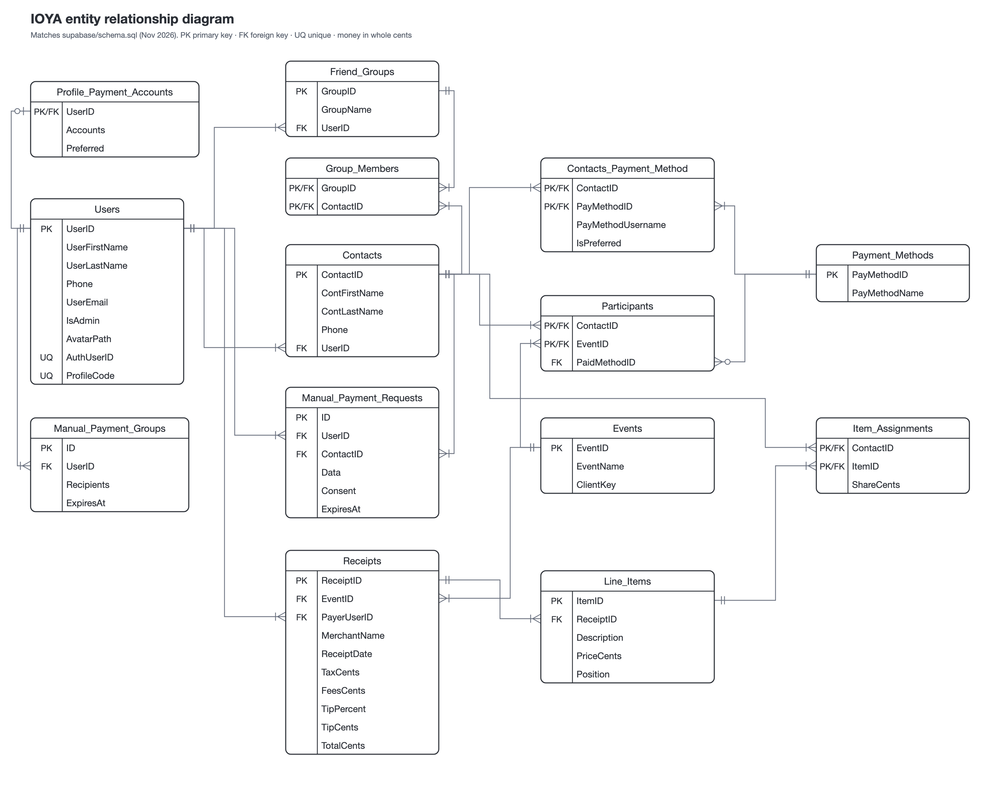
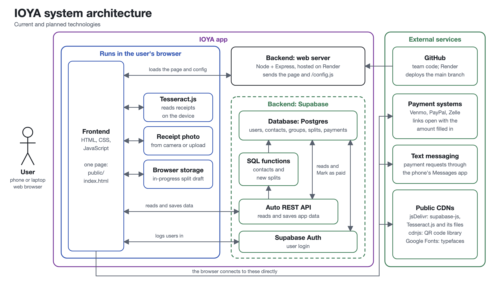
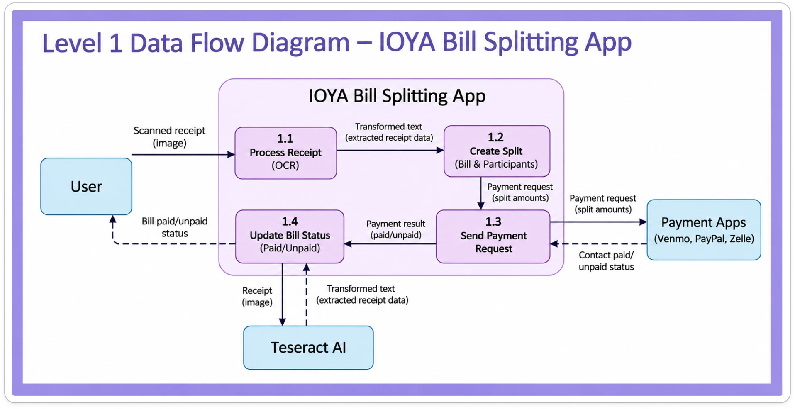
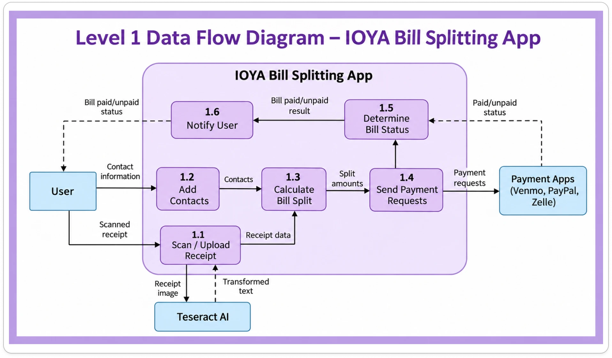

# IOYA

Scan a receipt, match items to friends, and make sure you get paid back.

**Team:** Jackson, Tye, Nick, Tanner

**Live app:** https://ioya.onrender.com (hosted on Render; it can take up to a minute to wake after sitting idle)

## App Summary

When one person pays a shared restaurant bill, they are left doing math on a receipt, splitting shared appetizers, spreading tax and tip fairly, and then chasing each friend for their share. That process is slow, easy to get wrong, and makes it easy to forget who still owes money. IOYA is for the person who picks up the tab for a group of friends, roommates, or family. The app turns a receipt into line items, lets the payer tap which friend had which item (including shared items), and splits tax, tip, and fees in proportion to what each person ordered. Each outing is saved as an event, so the Home screen's Paid / Unpaid board and the History screen show exactly who has paid you back and how. Saved contacts with their preferred payment method (Venmo, PayPal, Zelle, or cash) and friend groups like "Family" or "Lunch crew" make the next split faster.

## ERD



The original diagram is also in [`docs/ioya-erd.pdf`](docs/ioya-erd.pdf).

**Relationships and cardinality**

| Relationship | Cardinality | Through |
|---|---|---|
| Users → Contacts | one-to-many | `Contacts.UserID` |
| Users → Friend_Groups | one-to-many | `Friend_Groups.UserID` (live database; exported diagram update pending) |
| Users → Receipts (as the payer) | one-to-many | `Receipts.PayerUserID` |
| Friend_Groups ↔ Contacts | many-to-many | `Group_Members` |
| Contacts ↔ Payment_Methods | many-to-many | `Contacts_Payment_Method` (stores the username and whether it is preferred) |
| Events → Receipts | one-to-many | `Receipts.EventID` |
| Receipts → Line_Items | one-to-many | `Line_Items.ReceiptID` |
| Contacts ↔ Events | many-to-many | `Participants` |
| Payment_Methods → Participants (how they paid) | one-to-many | `Participants.PaidMethodID`, empty until the person pays |
| Contacts ↔ Line_Items | many-to-many | `Item_Assignments` (stores each person's share in cents) |

**How the diagram becomes tables.** The SQL in [`supabase/schema.sql`](supabase/schema.sql) uses the same 11 tables and columns, written in Postgres's lowercase snake_case style: `Users.UserFirstName` becomes `users.user_first_name`, `Contacts_Payment_Method` becomes `contacts_payment_method`, and so on. `IsPreffered` is spelled `is_preferred` in the database. Money is stored as whole cents, so `1959` means $19.59.

**Accounts.** Three columns are not in the ERD yet. `users.auth_user_id` links a row to its Supabase Auth account; it is empty for the sample users in `seed.sql`. `users.avatar_path` names the user's profile picture file in Supabase Storage (empty = no photo). `friend_groups.user_id` records which user owns a group, so each person can create and edit only their own groups.

**The payer is also a contact.** Each user has one row in `contacts` with the same name and phone as their `users` row. That lets the payer be a participant and be assigned items like everyone else, and the app shows that contact as "You."

## System Architecture



This diagram shows how IOYA is built today. Gray dashed boxes are planned and not built yet. (Profile pictures in Supabase Storage are now built; the diagram still draws them dashed until it is redrawn.) New splits are still kept only in the browser; saving them to the database is also planned.

## Data Flow Diagrams

Level 1 data flow diagrams showing how data moves between the user, IOYA's main processes, receipt reading and payment apps. We made two versions.

**Version 1**



**Version 2**



## Tech Stack

| Layer | What we used | Why |
|---|---|---|
| Database + backend | [Supabase](https://supabase.com) (hosted PostgreSQL with an automatic REST API) | Most of our group already knows Supabase, the free tier covers this project, and the Table Editor lets everyone see the data without installing a database. |
| Frontend | Plain HTML, CSS and JavaScript: the landing page [`public/index.html`](public/index.html) (`/`), the app [`public/app.html`](public/app.html) (`/app`) and the admin pages [`public/admin.html`](public/admin.html) (`/admin`), using the [`supabase-js`](https://supabase.com/docs/reference/javascript) library | Our screens started as one clickable HTML prototype, so we kept it and connected it to Supabase. There is no build step. |
| Web server | Node.js 18+ with Express, in [`server.js`](server.js) | Serves the page and passes it the Supabase URL and key from `.env`, so they are never committed to GitHub. |
| Receipt reader | [Tesseract.js 7.0.0](https://github.com/naptha/tesseract.js), loaded on the first scan | Reads photos in a browser worker without an OCR API key or uploading the photo to a recognition service. Its script, engine and English language data download from public CDNs. |
| Secrets | A git-ignored `.env` file | [`.env.example`](.env.example) shows the format. |

**Landing page and login.** The site opens on a landing page (`/`) with an image of the app, a short "How it works", and a **Log in** box (email and password). **Try IOYA** opens the app at `/app` without an account. When an **admin** logs in, the landing page shows **Maintain Users**, **Maintain Contacts**, **Maintain Groups**, **Maintain Splits** and **Maintain Payment Methods**, which open the admin pages at `/admin`; a regular user gets **Open IOYA** instead. **Log out** ends the login, deletes the login cookies and hides the buttons. The login is kept in **cookies** ([`public/session.js`](public/session.js)), shared by every page. Passwords are stored hashed by Supabase Auth, never in our tables. Admins are users with `users.is_admin = true` ([`supabase/admin-login.sql`](supabase/admin-login.sql)); the database checks this (`is_admin()`), so hiding the buttons is not the only protection.

**Maintain Users** (`/admin#users`, admins only) lists every user with their type (Admin, Profile, Guest, or No login for users added here) and how many contacts and splits they have. Admins can search, filter and sort, **View** a user's details, **Add** a user (name, email, phone, admin), **Edit** one (their "You" contact stays in sync), and **Delete** one after a confirmation that says exactly what goes (their contacts, groups and splits). Someone added here with an email is linked to that user when they first log in with that email. The email of someone who already logs in can't be changed here, and admins can't delete themselves or remove their own admin access. The database functions are in [`supabase/admin-users.sql`](supabase/admin-users.sql); each checks `is_admin()` first.

**Accounts.** Guests don't need to log in. The first time a browser opens the app, it signs in to Supabase anonymously, which creates a guest account, and the database function `ensure_my_user` creates that person's `users` row and their own "You" contact. The browser keeps the session, so the same person gets the same account on later visits. Clearing the browser's data or using a private window starts a new, empty account. A new account doesn't see the sample data in `seed.sql`, which belongs to the sample user, Demo Payer.

**Profile and saved accounts.** The **Profile** tab shows your profile card. Press the pencil to set your name, phone and **profile picture**; the database function `save_my_profile` (in [`supabase/profile.sql`](supabase/profile.sql)) updates your `users` row and your "You" contact together, so the app keeps recognizing which contact is you. A guest can **create a profile**: name, then email, then a 6-digit code that Supabase emails to confirm it, then a password. The same account (same data) becomes permanent. On another device or browser, **Log in** takes the email and password. **Forgot password?** emails a 6-digit code, then lets you choose a new password. Logged-in profiles can **Change password** and **Log out** (which deletes the login cookies and gives that browser a fresh guest account). A guest's data is not merged into a profile they log in to. Email addresses are kept by Supabase Auth, not in our tables.

**Profile pictures.** Only saved profiles can have a photo; guests see "Create a profile to add a profile picture." In edit mode, **Add photo** opens the phone's photo picker (or camera), then **Adjust your photo**: drag to move it, and zoom with the slider, a pinch on a phone, or the mouse wheel (keyboard: arrow keys and + / -). The part inside the circle is saved as a 400×400 JPEG (about 50 KB), made in the browser. It shows as a preview (with **Adjust** to reframe it) and uploads only when you press **Save**; **Cancel** throws it away. The photo then shows on the profile card and as the Profile tab's icon, with your initials as the fallback. Photos are stored in a public Supabase Storage bucket called `avatars`, one folder per account, set up by [`supabase/avatars.sql`](supabase/avatars.sql). Anyone with a photo's exact link can view it (the planned profile QR page needs that), but file names are random, so links can't be guessed and no one can list other people's photos. Each account can upload, replace and delete only its own files. Changing or removing a photo deletes the old file.

**Payment accounts.** The Profile tab lists the payment apps you've linked (Venmo, PayPal, Zelle, Cash App, Apple Cash) so friends can pay you, with readable handles (`@username`, `(801) 555-1234`). With none linked it shows **Add a payment app**. In the editor, each mistake gets its own red message (for example "Venmo usernames are at least 5 characters. This one has 3."), and you can mark one app as **Preferred**: it shows first with a star, and when a contact has no preferred app of their own, payment requests try yours first. Accounts are saved by `save_my_payment_accounts` ([`supabase/profile-payment-accounts.sql`](supabase/profile-payment-accounts.sql)); the preference by `set_my_payment_preference` ([`supabase/payment-preference.sql`](supabase/payment-preference.sql)). Guests can link payment apps too, since they need them to request money.

**Security.** The browser uses Supabase's public **anon** key. Row Level Security is on for every table, and the rules are in [`supabase/private-data.sql`](supabase/private-data.sql). Each account's data is private: a signed-in person can

- **read only their own rows**: their user row, their contacts and those contacts' payment usernames, their groups, and the splits they paid for (with those splits' items, participants and assignments). Everyone signed in can read the list of payment methods;
- **update only `participants.paid_method_id`** ("Mark as paid"), and only on their own splits;
- **add, edit and delete contacts** only through the database functions `save_contact` and `delete_contact`, and **groups** only through `save_group` and `delete_group`. They check the input, act only on the signed-in person's own contacts and groups, and make all their changes in one transaction. A contact who is on a past split can't be deleted, because that would erase their items from the receipt.

Someone with only the anon key and no session can't read or change anything.

Every other change has to be made in the Supabase dashboard. Never put the `service_role` key or the database password in `.env` or in the code.

**Saved to Supabase:** your guest account (and its email, once saved), your profile name and phone, contacts you add, edit or delete on the Contacts screen, and "Mark as paid." Each account can read only its own data (see Security).

**Receipt scanning:** Start split → Take photo or Upload photo → Check the items. On HTTPS or localhost, Take photo opens a live in-page preview when the browser supports it, after the user grants camera permission. It prefers the rear camera and does not request a microphone. Capture photo takes a still (or a video frame where needed) and reads it locally. The camera stops after capture, on closing, on leaving the capture view and when the tab is hidden/unloaded. On HTTP phone LAN addresses or unsupported browsers, Take photo uses the native camera/file picker instead. That fallback is also available explicitly. Choose a browser-readable image under 20 MB. The first scan needs internet to download the OCR reader. Check every item, tax, fees and printed total before continuing. Photos stay in memory; the editable draft is saved locally. Scanning does not save a receipt to Supabase.

Start split opens the camera directly; Resume current split continues the existing draft. The preview uses portrait proportions with compact controls below it, without simulated scanner animation. Its light stays off during preview. Capture photo requests a still-photo flash when supported, or briefly pulses a supported torch while taking the photo. Flash can be switched off. Failed light control offers retry/native capture rather than silently reading an unlit frame. The native fallback retains the phone's flash controls. Hardware support varies by browser. [`getUserMedia()` requires a secure context](https://developer.mozilla.org/en-US/docs/Web/API/MediaDevices/getUserMedia), so use the protected HTTPS preview below for phone testing.

The live feed fills the portrait preview without black bars. Embedded-camera captures are cropped to the same centered area visible at the moment you tap Capture photo, so OCR and Compare with receipt photo exclude content outside that frame. Still photos are decoded and mapped to the stream's centered aspect before applying the preview crop; video captures use the stream pixels directly. Keep the whole receipt inside the frame. Uploads and the native phone-camera picker use the chosen image, since this page does not control their preview.

New scans shorten item names locally by stripping obvious long product codes, expanding a small set of common abbreviations and keeping up to three words. No external AI service receives the receipt. This is conservative text cleanup, not product identification: unknown labels may still need editing. Meaningful short numbers such as 2%, V8 and 7UP are retained; prices, item IDs and assignments do not change. Review offers original labels and Use original name for changed items until refresh. Those source labels remain in tab memory, while the chosen editable names stay in the local draft. Shorten item names also applies the same cleanup to an existing scanned draft when requested.

**Tips:** Check the items starts with no tip selected. Tip is optional; leaving it unselected adds zero. Choose a percentage, choose No tip, or enter a custom dollar amount. Percentage and custom tips replace each other. Dollar amounts must be zero or positive with at most two decimal places; invalid entries block continuing/sending. All tips split proportionally to item shares, with cent rounding preserved. The summary labels custom dollar tips correctly. Older unsubmitted browser drafts keep their receipt/people/assignments but reset their old tip selection once; new explicit selections survive refresh. Past Supabase receipts are unchanged.

This first version recognizes English receipts with explicit US-dollar decimal prices. Blurry photos, multi-line items, discounts, included tips and unfamiliar layouts need manual correction. A missing total stays blank rather than being guessed. Unreadable images and reader/network failures offer another photo or Type it in; cancelling a scan preserves the previous draft. The app never fills in a sample receipt: the laptop screen list opens your own split, and with an empty split the later screens go to Check the items.

If the first read finds no priced items, misses the total, or its items/tax/fees do not match that total, the reader retries once using a single-column layout, skew correction and Sauvola thresholding for uneven lighting. It selects one complete reading by total reconciliation, then item count; item lists from different reads are never combined. This is a heuristic, not proof of accuracy. The parser also accepts spaces around an explicit decimal price and short store tax flags (for example `3 . 49 FN`).

If no items can be identified, the error distinguishes unreadable text from text whose prices could not be parsed. Expand **Text read from receipt** to compare the recognized text with the photo. That diagnostic text stays only in the tab's memory; it is not saved to localStorage or Supabase and is cleared on a new scan, cancellation, successful scan or manual entry. Fill the frame with a straight, focused receipt in bright, even light; flash can help but glare or motion blur still needs a better photo.

**Payment requests:** Review & Send prepares payment-app handoffs and one shared QR code for manual requests. Finish linked requests in the payment app. Venmo opens a best-effort prefilled **charge** link (request from that person); verify the fields because browser/app support varies. PayPal opens Request with copy buttons for the person's email, amount and note. Zelle requests are completed in your bank's app; IOYA shows the enrolled email/U.S. mobile number and links to the bank directory. Manual recipients scan the QR code and choose their name to see their share. No provider credentials or paid messaging service are required. See [Venmo's request flow](https://venmo.com/financial-education/how-to-send-receive-money), [PayPal's request links](https://www.paypal.com/us/cshelp/article/how-do-i-create-and-use-paypal-links-to-send-and-request-money-help1249) and [Zelle's bank-app flow](https://www.zelle.com/faq/how-can-i-use-zelle).

Copy contact, amount, note or all details; Request details / copy manually provides selectable text if clipboard access is unavailable. History → an unpaid person → Prepare reminder opens the same handoff with editable method/contact/note. Preparing, copying or opening a request does not mark it sent or paid: IOYA has no delivery or settlement callback. No automated requests or messages are sent. Keep using Mark as paid only after confirming payment.

Additional per-split methods are **Cash App, Apple Cash and Cash**. Cash App accepts a $cashtag, email or U.S. phone, opens its sign-in/app handoff and shows how to choose Request (minimum $1). Do not build a payment link to the debtor's $cashtag: that would pay the person who owes you. Cash App's own generated request links can allow eligible people without Cash App to pay using Apple Pay or Google Pay; IOYA does not generate those links. [Cash App instructions](https://cash.app/learn/getting-started/how-to-send-and-receive-money).

Apple Cash opens a Messages draft for the person's U.S. mobile number. On an eligible iPhone, choose + → Apple Cash → enter the amount → Request → send. The text draft is not itself an Apple Cash request. Apple Cash requires eligible Apple devices/accounts in the U.S.; an Android user cannot send one. This does not add Apple Pay merchant checkout, which needs a separate merchant/payment setup. [Apple Cash instructions](https://support.apple.com/en-us/105013), [Apple Pay setup](https://developer.apple.com/help/account/capabilities/configure-apple-pay-on-the-web). Cash needs no electronic contact and creates no external link; arrange collection in person. None of these options automatically mark payment received. Apple Cash reuses the contact's phone; Cash App details entered for a split stay in that local draft. The saved Contacts editor continues to use the methods already configured in Supabase; no lookup rows or SQL have been changed.

Return home preserves the local split and prepared requests; Resume current split reopens them. Editing the split hides stale handoffs until you prepare updated requests. A successful new scan or Type it in replaces the current draft as before. The old prototype QR/code and simulated delivery timers were removed; legacy simulated results are discarded on reload. No SQL migration is needed. New splits still are not saved to History.

**Groups on Contacts:** Choose New group, enter a name and select your contacts. Search narrows the member list without losing selected members. Empty groups are allowed. Tap an existing group to rename it or replace its members. Save reads back the database's row before updating the list; errors keep the entered name/selections, and retrying after a readback failure updates the saved ID instead of creating a duplicate. Delete group asks for confirmation and removes only the group, keeping contacts and past splits. Saved groups remain available when adding people to a split.

The editor uses the existing `save_group` and `delete_group` functions from `supabase/private-data.sql`; it needs no new SQL, grants or schema changes. Groups remain private to the signed-in account. The team still needs to update its source ERD and re-export `docs/ioya-erd.pdf` and `.png` to show required `Friend_Groups.UserID` → `Users.UserID` (one user owns many groups). Per `AGENTS.md`, that diagram edit belongs to the human team; the table above records the live database relationship without claiming the current diagram is updated.

## How to Get It Running

You need **Node.js 18 or newer** ([download](https://nodejs.org)) and a Supabase project.

### 1. Get the code

```bash
git clone https://github.com/mccleanjackson/ioya.git
cd ioya
npm install
```

### 2. Connect to a Supabase project

**Option A: use our team's existing project (teammates).** Ask a teammate for the project's **Project URL** and **anon public key** (shared privately, not in GitHub), and go to step 3.

**Option B: set up your own project from scratch.**

1. Sign in at [supabase.com](https://supabase.com) and create a new project (the free plan is fine).
2. Open **SQL Editor** → **New query**, paste the whole contents of [`supabase/schema.sql`](supabase/schema.sql), and click **Run**. You should see "Success. No rows returned."
3. Open another **New query**, paste all of [`supabase/seed.sql`](supabase/seed.sql), and click **Run**. The result shows a `setval` column; that is expected.
4. In **Table Editor** you should now see 11 tables, each with sample rows. (`schema.sql` already includes the contact and account functions, so you don't need to run `contacts-sync.sql` or `anonymous-accounts.sql` separately.)
5. Open **Authentication → Sign In / Providers** and turn on **Allow anonymous sign-ins**, then click **Save**. Without it, the app shows "Guest accounts are turned off."
6. Open **Authentication → URL Configuration**. Set **Site URL** to your live address (ours is `https://ioya.onrender.com`) and add `http://localhost:3001/**` under **Redirect URLs**.
7. For saving accounts with email (see "Set up account emails" below): check that **Authentication → Sign In / Providers → Email** is on, put the 6-digit code in the email templates, and, so anyone can receive the emails, set up your own email sender.
8. Find your **Project URL** and **anon public key** under **Project Settings → API** (or the **Connect** button).

#### Set up account emails (6-digit codes) and passwords

The app emails a 6-digit code to confirm a new profile's email and to reset a forgotten password; everyday logins use the password. Do this once per Supabase project (our team's project is already set up).

1. **Authentication → Sign In / Providers → Email**: make sure it is **enabled**, leave **Confirm email** on, and set **Email OTP Length** to `6` (the app says "6-digit code"; some projects default to 8).
2. **Authentication → Emails → Templates**: in each of **Magic Link**, **Change Email Address**, **Confirm signup** and **Reset Password**, replace the message body with the following and click **Save**:

   ```html
   <h2>Your IOYA code</h2>
   <p>Enter this code in IOYA:</p>
   <p style="font-size:28px;font-weight:bold;letter-spacing:4px">{{ .Token }}</p>
   <p>It expires in 1 hour. If you didn't ask for it, you can ignore this email.</p>
   ```

   A subject like `Your IOYA code` works for all four. The app has no link-based sign-in, so the templates don't need a link.
3. **Your own email sender (needed for anyone outside the Supabase team).** Supabase's built-in sender only delivers to members of the Supabase project and only a few emails per hour. So that a TA or anyone else can save an account, open **Authentication → Emails → SMTP Settings**, turn on **Enable custom SMTP**, and fill in a real email account's SMTP details. With a Gmail account made for the project (recommended over a personal one): host `smtp.gmail.com`, port `465`, username = the full Gmail address, password = a Gmail **app password** (Google Account → Security → 2-Step Verification must be on, then **App passwords**), sender email = that Gmail address, sender name `IOYA`. Never commit the app password or put it in `.env`.
4. **Passwords:** in **Authentication → Sign In / Providers → Email**, set **Minimum password length** to `8` (the app asks for at least 8) and click **Save**.
5. **Authentication → Rate Limits**: after custom SMTP is on, check **Rate limit for sending emails** (for example 30 per hour) is enough for testing.

### 3. Create your `.env` file

```bash
cp .env.example .env
```

Open `.env` and fill in the two values from step 2:

```
SUPABASE_URL=https://YOUR-PROJECT-ID.supabase.co
SUPABASE_ANON_KEY=your-anon-public-key
```

`.env` is listed in `.gitignore`, so it is never committed.

### 4. Start the app

```bash
npm start
```

Open **http://localhost:3001** for the landing page, or **http://localhost:3001/app** for the app. On a laptop the app appears in a phone frame, with a list of screens on the left.

#### Make an admin account

Admins see the **Maintain** buttons. To make one: create a profile (or, for a TA, add the user in **Authentication → Users → Add user → Create new user** with an email and password and **Auto Confirm User** checked), **log in with it once** on the landing page, then run this in the SQL Editor with that email:

```sql
UPDATE users SET is_admin = true WHERE lower(user_email) = lower('their@email.com');
```

Log out and back in to see the buttons. To remove admin access, run the same line with `false`.

### 5. Optional protected HTTPS phone preview

Install the official [cloudflared client](https://developers.cloudflare.com/tunnel/downloads/) with protected Quick Tunnel support (`--allowed-mail`). Keep IOYA running, then in PowerShell:

```powershell
.\scripts\start-https-preview.ps1 -Email "you@example.com" -CloudflaredPath "C:\path\to\cloudflared.exe"
```

The launcher requires one exact email address and refuses clients without email protection. It uses an explicit empty tunnel configuration so unrelated user tunnel settings are not imported. Cloudflare prints a temporary HTTPS address; open it on the phone and enter the email PIN there. Do not share sign-in codes in chat. This routes app traffic through Cloudflare with access restricted to that email, under [Cloudflare's terms](https://www.cloudflare.com/website-terms/). It is for development, needs the computer awake, changes URL after restart, and ends with Ctrl+C. No router ports, trusted-root certificates or Windows services are installed. [Protected Quick Tunnel documentation](https://developers.cloudflare.com/tunnel/get-started/quick-tunnels/).

The HTTPS address is a new browser origin: its local draft and camera permission are separate from the old HTTP page. Old drafts remain on their original address. On the HTTPS page, choose Take photo, grant camera permission, check the Light/Flash indicator, and capture a real receipt. Never use an unprotected public preview for the shared team app.

**Troubleshooting**

- `Missing SUPABASE_URL or SUPABASE_ANON_KEY`: `.env` is missing, misnamed, or not in the project folder.
- "Couldn't load your data" in the app: check that the URL and key in `.env` match your project, that you ran both SQL files, and that your internet connection works. Restart `npm start` after editing `.env`.
- "Guest accounts are turned off": turn on **Allow anonymous sign-ins** (step 2, item 5).
- "The database is missing the accounts update", or `Could not find the function public.save_contact`: the project was set up before accounts were added. Run [`supabase/anonymous-accounts.sql`](supabase/anonymous-accounts.sql) once in the SQL Editor.
- "Too many new accounts were created from this network": Supabase limits how many guest accounts one network can create per hour. Wait, or reuse a browser that already has an account.
- `permission denied` when saving: you are trying to change something other than a contact or "Mark as paid," which the security rules block on purpose.
- "The database is missing the profile update": run [`supabase/profile.sql`](supabase/profile.sql) once in the SQL Editor.
- "Profile photos aren't set up in the database yet", or "Couldn't load your data" mentioning `avatar_path`: run [`supabase/avatars.sql`](supabase/avatars.sql) once in the SQL Editor.
- "the preferred app needs a database update": run [`supabase/payment-preference.sql`](supabase/payment-preference.sql) once in the SQL Editor (your accounts were already saved).
- "This browser couldn't open that photo": some desktop browsers can't read iPhone HEIC photos. Choose a JPG or PNG, or add the photo from the phone (iPhones convert it automatically).
- The code email never arrives: check spam, then **Authentication → Emails → SMTP Settings** (without your own sender, only Supabase project members get emails) and Supabase's **Logs → Auth** for the error. "The email could not be sent" in the app means the SMTP details are wrong.
- "This email already has an IOYA profile": use **Log in** instead of **Create profile**.
- "That email and password don't match": check both, or use **Forgot password?**. Profiles created before passwords existed have no password yet; **Forgot password?** sets one.
- "The database needs an update: run supabase/admin-users.sql" on the Users page: run that file once in the SQL Editor.
- No **Maintain** buttons after logging in: the account isn't an admin yet (see "Make an admin account"), or `supabase/admin-login.sql` hasn't been run.
- The password-reset email has a link instead of a code: add `{{ .Token }}` to the **Reset Password** template (setup step 2 above).
- The email has an 8-digit code but the app asks for 6: set **Email OTP Length** to `6` (setup step 1 under "Set up account emails").
- The code is rejected: codes expire after an hour and each new code replaces the last one, so use the newest email.

## Verifying the Vertical Slice

### Check the receipt-photo flow

1. Start a split and choose Take photo on a phone or Upload photo on a computer. Use a clear, straight photo of a receipt with item names and decimal prices.
2. Wait for the reader, then compare the extracted item names/prices, tax, service fees and printed total with the photo in Check the items. Correct a price and confirm that the subtotal and mismatch warning update. Add any missed lines and remove any false matches.
3. Verify no tip starts selected. Enter a custom dollar tip, check the total, switch to a percentage, and then clear the custom field to leave no selection. A negative or invalid amount must block continuing. In the final summary, confirm everyone's shares add up to the bill plus the chosen tip.
4. Try a blank image and confirm that the app offers retry and Type items instead without loading sample items. Cancel a scan and confirm that a previous draft is preserved. Check both phone and laptop widths.
5. Continue through People → Assign items → Review & send → Prepare requests. Check each contact, amount and note. Use fake details for software testing and stop before sending a real request. Confirm Return home → Resume current split preserves the draft and editing requires updated handoffs. Check Home, History and Contacts too; no Supabase migration is needed for scanning, tips or request handoffs.

### Check payment-app handoffs

1. Prepare a split with Venmo, PayPal and Zelle contacts. Confirm shares including cent rounding. Invalid contacts must show an error and be skipped; unassigned items, invalid tips and mismatched totals must block preparation.
2. On a physical phone, open Venmo and confirm Request mode, person, amount and note. If prefill is unavailable, copy the details. In PayPal, choose Request and paste them. In Zelle, open your bank's app and choose Request. Only a student intending to send a real request should complete the final action.
3. Check copy/manual fallback, notes, refresh/resume and History reminders at phone and laptop widths. Opening a provider must leave paid status unchanged. Automated tests use isolated data and send no real requests.
4. Choose Apple Cash and verify the Messages draft shows the right person and amount on an eligible physical iPhone, then check the native Request step yourself. Try Cash App with a $cashtag and a sub-dollar share (it must offer another method), and Cash with no contact details. Cash must show collection instructions with no launch link. Verify the new choices also appear in reminder preparation.

**AI assistance for this feature:** AI implemented provider handoffs, validation, exact-share snapshots, clipboard/manual fallback, reminder preparation, stale-request protection, draft preservation and software checks. Students must verify their own payment apps and disclose this assistance accurately. Software checks are not student-authored course testing or findings.

Run `npm test` for deterministic receipt-parser checks. These are software checks, not student-authored usability, accessibility or course-assignment findings. Students should perform and record their own required testing and disclose AI assistance accurately.

### Check group editing

1. On Contacts, create a group with two test contacts, refresh and check its name/members. Rename it, replace a member, save and refresh again. Verify searching the picker preserves hidden selections and that an empty group can be saved.
2. Try a blank name and confirm the error. A failed save must keep the typed name and selections. Check the saving state and phone/laptop layouts.
3. Open a group, choose Delete group, cancel once, then confirm deletion of your test group. Refresh and confirm the group is gone while contacts and past splits remain. A group should also be selectable in the split's People step without adding duplicate people.
4. In an authorized live test, confirm the saved `friend_groups.user_id` belongs to the signed-in guest/profile in Supabase Table Editor and clean up test records. The isolated local preview uses a fake database; its refresh checks do not establish live Supabase deployment state.

**AI assistance for groups:** AI implemented the Contacts group editor, member search/selection, save/readback/retry handling, delete confirmation, error/saving states and software checks. Students remain responsible for their required course testing, findings, disclosure and the team-owned ERD update.

### Existing database vertical slice

**The button:** **Save** when adding a contact on the **Contacts** screen. (This is the action shown in our demo video.)

**What happens:**

1. The app sends a request to Supabase that calls the `save_contact` function with the name, phone and payment usernames you typed.
2. Supabase inserts a row into `contacts` and one row into `contacts_payment_method` for each payment method, in one transaction.
3. Supabase returns the saved contact (with its new `contact_id`) to the app.
4. The app adds the contact to the list and shows "Saved Alex Johnson."

**Steps:**

1. Open http://localhost:3001 and tap **Contacts** in the bottom bar.
2. Scroll down and tap **Add contact**.
3. Enter **First name** `Alex`, **Last name** `Johnson`, and a **Venmo** username such as `@alex-johnson`. Select **Preferred** next to Venmo.
4. Tap **Save**. The sheet closes, a "Saved Alex Johnson." message appears, and Alex Johnson is at the bottom of the contacts list with Venmo as the preferred payment.
5. **Refresh the page** (Cmd+R or Ctrl+R) and open **Contacts** again. Alex Johnson is still there, because the list is loaded from Supabase.
6. Optional: in Supabase, open **Table Editor → contacts**. Alex Johnson is a new row, and **contacts_payment_method** has a row with that `contact_id`, `@alex-johnson`, and `is_preferred` = true. (The Table Editor may need its refresh button to show rows added since you opened it.)

**To clean up:** tap Alex Johnson on the Contacts screen and choose **Delete**.

**A second working example: "Mark as paid."** This needs a saved split, so it only works for an account that has one. A new guest account has none, because the sample splits belong to Demo Payer and new splits aren't saved yet. On the **Home** screen, tap someone in the **Unpaid** column, choose how they paid, and tap **Mark as paid**. The app updates `participants.paid_method_id` in Supabase and moves them to the **Paid** column, and they stay there after a refresh. Tap them again and choose **Mark as unpaid** to undo it.

## Project Layout

```
server.js              Serves public/ and /config.js (Supabase URL + anon key from .env)
public/index.html      The landing page (/): hero image, How it works, Log in, admin Maintain buttons, Log out
public/app.html        The app (/app): screens, styles, and Supabase calls
public/admin.html      Admin Maintain pages (/admin), admins only
public/session.js      Keeps the Supabase login in cookies (shared by all three pages)
public/images/         Screenshots of the app used on the landing page
supabase/schema.sql    Creates the 11 tables, security rules and contact/group functions (drops existing tables first)
supabase/contacts-sync.sql  Adds just the contact functions to a project set up before they existed (older version)
supabase/anonymous-accounts.sql  Guest accounts: links users to Supabase Auth and updates the contact functions
supabase/private-data.sql  Makes each account's data private, gives groups an owner, adds save_group/delete_group
supabase/profile.sql   Adds save_my_profile (name and phone for the Profile screen)
supabase/avatars.sql   Profile pictures: the avatars storage bucket and its rules, users.avatar_path, set_my_avatar
supabase/admin-users.sql  Maintain Users: admin_list_users, admin_save_user, admin_delete_user; links a first login to an admin-added user
supabase/admin-login.sql  users.user_email, users.is_admin, is_admin(); ensure_my_user() keeps user_email current
supabase/payment-preference.sql  Preferred payment app: profile_payment_accounts.preferred, get/set_my_payment_preference
supabase/seed.sql      Sample rows for every table
docs/ioya-erd.pdf      Our ERD (docs/ioya-erd.png is the same diagram for this README)
.env.example           Template for your .env file
```

## Local review and manual payments

For an isolated review, install dependencies and run `$env:IOYA_PREVIEW='1'; $env:PORT='3003'; npm.cmd start` in PowerShell. Open `http://127.0.0.1:3003/` and select **Try an example split**. The example includes a linked contact and two manual recipients who share a QR code. Preview links use local in-memory data, expire on server restart, and open on the same computer. Payment app launches are disabled in preview.

For deployment, apply `supabase/manual-payment-requests.sql`, `supabase/shared-manual-payment-requests.sql`, and `supabase/manual-payment-profile-methods.sql` in Supabase's SQL Editor after the base account and private-data migrations. Apply `supabase/profile-payment-accounts.sql` after `supabase/private-data.sql` to enable saving payment accounts. Apply `supabase/contact-payment-methods.sql` to make Cash App and Apple Cash available in Contacts. The QR flow requires no Twilio environment variables or `supabase/manual-payment-sms.sql`. New QR codes open the deployed `/pay` page without sign-in. Render supplies its public HTTPS URL automatically. Set `IOYA_PUBLIC_ORIGIN` to use a custom domain. Public links expire after seven days.

Review shows a request section with the saved payment account and an editable note for linked payment-app requests. Manual recipients show only their items and total. IOYA uses a contact's preferred payment app when both people have saved account details. For a contact without a preference, IOYA uses an eligible shared app if one exists. Everyone else shares a single QR code, regardless of whether they have a phone number. The payer finishes linked requests in the payment app and selects **I sent the request** to update the status. **Edit split** lets the payer revise the split. Preparing again creates updated links when the recipient’s share or routing changes. Anyone with the shared QR link can view the listed names and select a share. In preview, splits without a QR recipient go straight to local preview History. Before release, open a shared QR on the deployed HTTPS site in a signed-out browser and check the provider handoffs with test accounts. The recipient page offers a Venmo handoff with copyable details, a PayPal.Me link for the amount, plus copyable instructions and app entry points for PayPal email, Zelle, Cash App, and Apple Cash. Apple Pay is available when the payer supplies an Apple Pay-enabled Stripe checkout URL for that recipient's exact amount and currency. IOYA does not create the Stripe checkout or confirm payments. The recipient can optionally share an account identifier they enter themselves. The payer reviews the submitted value before saving it to the contact.

AI assistance for this change covered the contact and group picker, item assignment UI, manual payment links and recipient page, QR-only delivery for manual requests, and automated verification.
