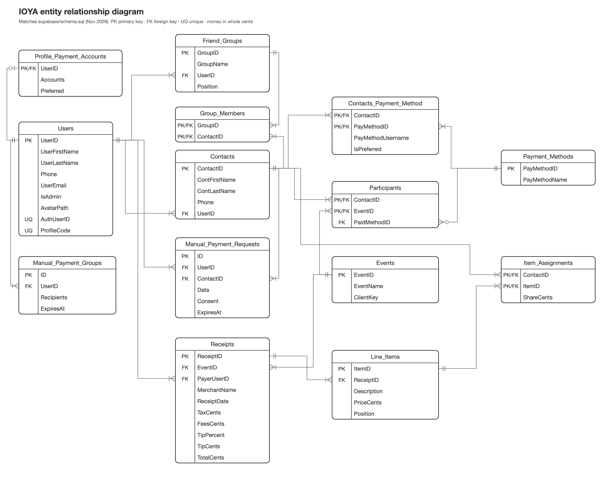
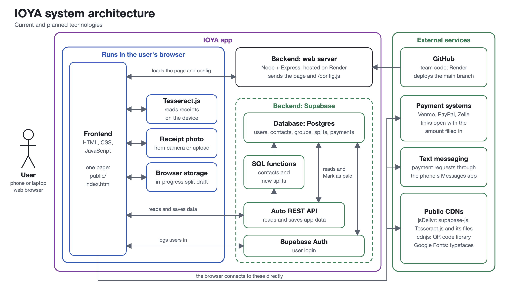
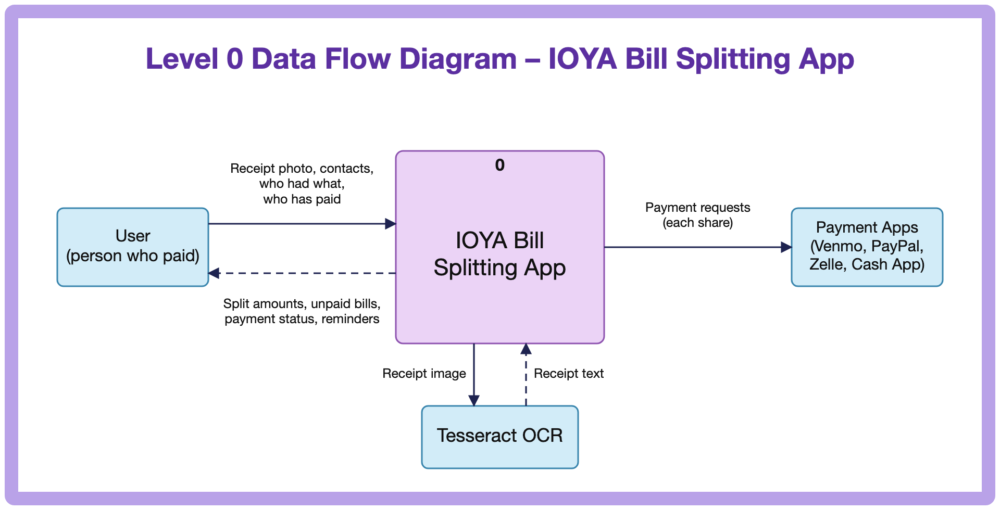
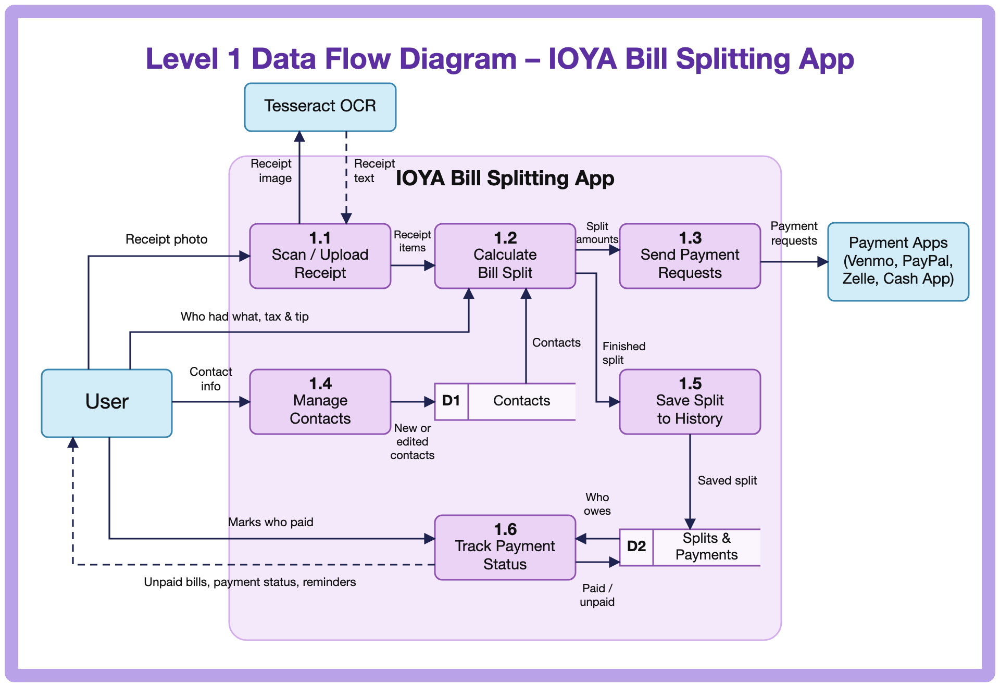

# IOYA

Scan a receipt, match items to friends, and make sure you get paid back.

**Team:** Jackson, Tye, Nick, Tanner

**Live app:** https://ioya.onrender.com (hosted on Render; it can take up to a minute to wake after sitting idle)

## App Summary

When one person pays a shared restaurant bill, they are left doing math on a receipt, splitting shared appetizers, spreading tax and tip fairly, and then chasing each friend for their share. That process is slow, easy to get wrong, and makes it easy to forget who still owes money. IOYA is for the person who picks up the tab for a group of friends, roommates, or family. The app reads a photo of the receipt into line items, lets the payer tap which friend had which item (including shared items), and splits tax, tip, and fees in proportion to what each person ordered. It then creates a shared QR code for everyone who owes a share. Friends scan the code and choose their name to see their share and the payer's available payment options. Saved splits go to History, Home shows who still owes you, and text reminders are one tap away. Saved contacts, friend groups like "Lunch crew", and a shareable profile with your own payment apps make the next split faster. Anyone can start as a guest; a profile (email and password) keeps your data across devices, and admins get pages to maintain every table.

## ERD



The same diagram is in [`docs/ioya-erd.pdf`](docs/ioya-erd.pdf), and its source is [`docs/ioya-erd.svg`](docs/ioya-erd.svg). It was redrawn in November 2026 to match the current database; the team's original October diagram is kept in [`docs/ioya-erd-original.png`](docs/ioya-erd-original.png) and [`.pdf`](docs/ioya-erd-original.pdf).

**Relationships and cardinality**

| Relationship | Cardinality | Through |
|---|---|---|
| Users → Contacts | one-to-many | `Contacts.UserID` |
| Users → Friend_Groups (the owner) | one-to-many | `Friend_Groups.UserID` |
| Users → Receipts (as the payer) | one-to-many | `Receipts.PayerUserID` |
| Users → Profile_Payment_Accounts | one-to-zero-or-one | `Profile_Payment_Accounts.UserID` (the payer's own Venmo, PayPal… accounts) |
| Users → Manual_Payment_Requests | one-to-many | `Manual_Payment_Requests.UserID` |
| Users → Manual_Payment_Groups | one-to-many | `Manual_Payment_Groups.UserID` (one shared QR code for a split) |
| Contacts → Manual_Payment_Requests | one-to-many | `Manual_Payment_Requests.ContactID` (the friend the link is for) |
| Friend_Groups ↔ Contacts | many-to-many | `Group_Members` |
| Contacts ↔ Payment_Methods | many-to-many | `Contacts_Payment_Method` (stores the username and whether it is preferred) |
| Events → Receipts | one-to-many | `Receipts.EventID` |
| Receipts → Line_Items | one-to-many | `Line_Items.ReceiptID` |
| Contacts ↔ Events | many-to-many | `Participants` |
| Payment_Methods → Participants (how they paid) | one-to-zero-or-many | `Participants.PaidMethodID`, empty until the person pays |
| Contacts ↔ Line_Items | many-to-many | `Item_Assignments` (stores each person's share in cents) |

**How the diagram becomes tables.** The SQL in [`supabase/schema.sql`](supabase/schema.sql) uses the same tables and columns, written in Postgres's lowercase snake_case style: `Users.UserFirstName` becomes `users.user_first_name`, `Contacts_Payment_Method` becomes `contacts_payment_method`, and so on. Money is stored as whole cents, so `1959` means $19.59. One table in `schema.sql` is not drawn: `manual_payment_sms`, which is only for an optional text-message feature the live app doesn't use.

**Accounts.** `Users.AuthUserID` (unique) links a row to its Supabase Auth login; it is empty for the sample users in `seed.sql` and for users an admin adds before they log in. `UserEmail` is the login email, `IsAdmin` marks admins, `AvatarPath` names the profile picture file in Supabase Storage (empty = no photo), and `ProfileCode` (unique) is the random code in a shared profile link, `/u/<code>` (empty until the person first taps **Share my profile**). `Friend_Groups.Position` is the group's place in its owner's list on the Contacts tab (empty until they reorder). `Events.ClientKey` is a random key the app sends with **Save to History** so a split is never saved twice. `Events.CreatedAt` is when the split was saved and `Participants.PaidAt` is when the payer marked that person paid (both used by the OKR page; empty for splits saved before it). `Profile_Payment_Accounts.Accounts` and `Manual_Payment_Requests.Data` hold several values in one JSON column.

**The payer is also a contact.** Each user has one row in `contacts` with the same name and phone as their `users` row. That lets the payer be a participant and be assigned items like everyone else, and the app shows that contact as "You."

## System Architecture



This diagram shows how IOYA is built: the three pages (landing, app, admin) and the login cookies in the browser; Supabase for the database, functions, login and profile pictures; and the Express server on Render, which serves the pages, the payment-request links and the shared profile pages. Its source is [`docs/ioya-architecture.svg`](docs/ioya-architecture.svg).

## Data Flow Diagrams

### Level 0 (context diagram)



The whole app is one process. **The user** (the person who paid) sends in the receipt photo, their contacts, who had what, and who has paid; IOYA sends back each person's share, unpaid bills, payment status and reminders. **Tesseract OCR** turns the receipt image into text. **Payment apps** receive the payment request for each share. Payment apps don't report back to IOYA, so the user marks people as paid.

### Level 1



| Process | What it does |
|---|---|
| 1.1 Scan / Upload Receipt | Takes a photo (or upload, or typed items), sends the image to Tesseract OCR, and turns the text into receipt items, tax and total. |
| 1.2 Calculate Bill Split | Combines the items with who had what, tax and tip, and the user's contacts, and works out each person's exact share in cents. |
| 1.3 Send Payment Requests | Creates one shared QR code for everyone who owes a share. |
| 1.4 Manage Contacts | Adds, edits, imports and deletes contacts and groups. |
| 1.5 Save Split to History | Saves the finished split (receipt, items, shares, people). |
| 1.6 Track Payment Status | Shows who still owes, records who paid, and prepares reminders. |

The two data stores are tables in Supabase: **D1 Contacts** (`contacts`, `contacts_payment_method`, `friend_groups`, `group_members`) and **D2 Splits & Payments** (`events`, `receipts`, `line_items`, `item_assignments`, `participants`). Sources: [`docs/ioya-dfd-level0.svg`](docs/ioya-dfd-level0.svg) and [`docs/ioya-dfd-level1.svg`](docs/ioya-dfd-level1.svg). The team's two earlier Level 1 drafts are kept in [`docs/ioya-dfd-level1-original-v1.png`](docs/ioya-dfd-level1-original-v1.png) and [`v2`](docs/ioya-dfd-level1-original-v2.png).

## Tech Stack

| Layer | What we used | Why |
|---|---|---|
| Database + backend | [Supabase](https://supabase.com) (hosted PostgreSQL with an automatic REST API, Auth and Storage) | Most of our group already knows Supabase, the free tier covers this project, and the Table Editor lets everyone see the data without installing a database. Login, guest accounts and profile pictures come with it. |
| Frontend | Plain HTML, CSS and JavaScript: the landing page [`public/index.html`](public/index.html) (`/`), the app [`public/app.html`](public/app.html) (`/app`), the admin pages [`public/admin.html`](public/admin.html) (`/admin`), the payment page [`public/pay.html`](public/pay.html) (`/pay`) and the shared profile page [`public/profile.html`](public/profile.html) (`/u/<code>`), using the [`supabase-js`](https://supabase.com/docs/reference/javascript) library | Our screens started as one clickable HTML prototype, so we kept it and connected it to Supabase. There is no build step. |
| Web server | Node.js 18+ with Express, in [`server.js`](server.js), hosted on [Render](https://render.com) | Serves the pages and passes them the Supabase URL and key from `.env`, so they are never committed to GitHub. Also runs the payment-request links and shared profile pages, and makes their QR codes with the [`qrcode`](https://www.npmjs.com/package/qrcode) package. |
| Receipt reader | [Tesseract.js 7.0.0](https://github.com/naptha/tesseract.js), loaded on the first scan | Reads photos in the browser without an OCR API key or uploading the photo to a recognition service. Its script, engine and English language data download from public CDNs. |
| Secrets | A git-ignored `.env` file | [`.env.example`](.env.example) shows the format. |

## Features

### Landing page, login and accounts

- **Landing page (`/`).** Pictures of the app, a short "How it works", and **Log in** (email and password). **Try IOYA** opens the app at `/app` without an account. On laptops, a **Scan to open IOYA on your phone** QR code (made by the server at `/qr.png` with the site's public address) lets people open the site from a screen or projector. **Log out** ends the login and deletes the login cookies ([`public/session.js`](public/session.js) keeps the login in cookies shared by every page).
- **Guests.** The first time a browser opens the app, it signs in to Supabase anonymously, and `ensure_my_user` creates that person's `users` row and their "You" contact. The same browser keeps the same account. Clearing the browser's data or using a private window starts a new, empty account.
- **Profiles.** A guest can **create a profile** on the Profile tab: name, then email, then a 6-digit code that Supabase emails to confirm it, then a password. The same account (same data) becomes permanent. On another device, **Log in** with the email and password; **Forgot password?** emails a code to choose a new one. A guest's data is not merged into a profile they log in to. Passwords and emails are kept by Supabase Auth, not in our tables.
- **Profile tab.** Shows your name, phone, email, number of splits and contacts, and how much you're owed. The pencil edits your name, phone and **profile picture** (saved profiles only): drag and zoom to frame it, and it's saved as a small JPEG in a public Storage bucket with a random file name ([`supabase/avatars.sql`](supabase/avatars.sql)).
- **Your payment accounts.** Link Venmo, PayPal, Zelle, Cash App and Apple Cash so friends can pay you, and mark one as **Preferred**. Each mistake gets its own red message.
- **Share my profile.** Saved profiles get a QR code and link (`/u/<random code>`). Anyone who scans it sees your name, photo and payment apps (preferred first) with buttons that open Venmo, PayPal or Cash App, or copy your Zelle or Apple Cash details. Nothing else is shown. **Make a new link** replaces the code, and the old link stops working ([`supabase/profile-share.sql`](supabase/profile-share.sql)).

### Splitting a bill

1. **Pay New Tab** on Home opens the camera. Take a photo, **Upload** one, or **Type** the items in. After taking a photo you can adjust its brightness, save it to your device, and then **Use photo**. Tesseract reads it in the browser; nothing is uploaded to a recognition service. The camera needs HTTPS or localhost; otherwise the phone's own camera picker is used.
2. **Check the items.** Fix any names or prices, set quantities, enter tax and **Tip and fees** (one dollar amount), and confirm the **Total to split** matches the receipt. Long scanned names are shortened, and **Use original name** undoes it.
3. **Match items.** Add people from Contacts or groups, or create a **New contact** right there (it's saved to Contacts too). Tap a person, then tap their items. Shared items are split evenly.
4. **Review & send.** Shows each person's items and their share of tax, fees and tip (in proportion to what they ordered, rounded so every cent adds up to the bill). **Create payment QR code** opens one shared `/pay` page for everyone who owes a share, including contacts with saved payment apps. Each person selects their name to see their items, exact amount, and payment options.
5. **Save to History** saves the split to Supabase with everyone as "not paid yet" ([`supabase/save-splits.sql`](supabase/save-splits.sql)). A split is never saved twice, even after a double tap. **Not now** keeps it in the browser, and **Resume current split** on Home picks it back up.
6. **Discard split** (top of every split screen, or next to Resume on Home) throws an unfinished split away after asking first.

IOYA never sends money or marks anyone paid by itself: payment apps don't report back, so the payer marks people as paid. This version reads English receipts with US-dollar prices; blurry photos, multi-line items and discounts may need fixing by hand.

**Payment apps.** Venmo opens a prefilled request; PayPal opens Request with copy buttons; Zelle shows the account to use in your bank's app; Cash App and Apple Cash give step-by-step instructions (Apple Cash opens a Messages draft); Cash needs no link. If the clipboard is blocked, **Request details** shows selectable text.

### Home, History and reminders

- **Home** lists unpaid bills and the total friends owe you. Open a bill to see who still owes, then tap a person to **Mark as paid** (choose how they paid) or **Mark as unpaid**.
- **Prepare text reminders** writes one message per person with their unpaid bills and total; **Open text** opens your messaging app with it, or **Copy message**.
- **History** shows every saved split, a status bar with how many are **Paid**, **Partly paid** and **Unpaid**, search, and **All / Unpaid / Partly paid / Paid** filters. Open a split to see the receipt and each person's share, mark payments, or prepare a reminder.

### Contacts and groups

- Add, edit and delete contacts with their phone and payment usernames (★ = preferred). A contact on a past split can't be deleted, because that would erase their items from the receipt.
- **Import device contacts** uses the phone's contact picker where supported, or a `.vcf` file. You review the list and tick who to save; only names and the first phone number are used, and people you already have are skipped.
- **Groups** (for example "Lunch crew") can be added to a split in one tap. Search keeps your selections, empty groups are allowed, and deleting a group keeps its contacts.
- **Reorder groups** by dragging them on the Contacts tab (on a phone, hold for a moment, then drag; on a keyboard, Alt + ← / →). The order is saved to your account ([`supabase/group-order.sql`](supabase/group-order.sql)) and is also used in the split's Add Contacts list.

### OKR page (`/okrs`)

Our four key results, counted live across the whole app (all time) and refreshed every 5 seconds. Anyone can open it from the landing page (**OKRs**); it shows only totals, never names. The payer's own share is never counted, and "paid" means the payer pressed **Mark as paid**.

| Objective | Key result | How it's counted | Action in the app that moves it |
|---|---|---|---|
| A. Increase the % of people who pay back the payer | 1. % of splits fully paid back | Splits where everyone is marked paid ÷ all splits with at least one other person | Save a split (goes down), then mark everyone on it paid (goes up) |
| | 2. Of splits not fully paid back, % of the bill paid back | Dollars marked paid ÷ dollars owed on those splits (tax, fees and tip included) | Mark one person paid on a split that still has unpaid people |
| B. Decrease the time it takes a group to pay back the payer | 3. % of people paid back within 24 hours | People marked paid within 24 hours of the split being saved ÷ people who have paid or whose split is over 24 hours old | Save a split, then mark someone paid right away |
| | 4. Average time to pay back (whole app) | Average time from saving a split to marking each person paid | Save a split, then mark someone paid |

The numbers come from `okr_stats()` ([`supabase/okrs.sql`](supabase/okrs.sql)), which returns only totals. A database trigger records when each person is marked paid, so key results 3 and 4 count splits saved after `okrs.sql` was run.

### Admin pages (`/admin`)

Admins (`users.is_admin = true`) see **Maintain Users, Contacts, Groups, Splits and Payment Methods** on the landing page, and an **Admin tools** button on the Profile tab. Each page has search, filters, sorting, **View**, **Add**, **Edit** and **Delete** (with a confirmation that says exactly what goes), and red messages under the field that needs fixing. Highlights:

- **Users:** type (Admin, Profile, Guest, or No login), contacts and splits per user. A user added with an email is linked when they first log in. Admins can't delete themselves or remove their own admin access.
- **Contacts and Groups:** every user's records with their owner; a new one is added for a chosen user.
- **Splits:** who paid, merchant, date, total and how many have paid back. Add and Edit use one form with item rows, who shares each one, and **Paid with…** for each person; totals update as you type. Saving replaces the whole split in one step, so a failed save never leaves half a split.
- **Payment Methods:** the six built-in apps are locked; admins can add others (for example Google Pay).

The database checks `is_admin()` in every admin function, so hiding the buttons is not the only protection ([`supabase/admin-login.sql`](supabase/admin-login.sql), [`admin-users.sql`](supabase/admin-users.sql), [`admin-records.sql`](supabase/admin-records.sql), [`admin-splits.sql`](supabase/admin-splits.sql)).

### Security

The browser uses Supabase's public **anon** key, and Row Level Security is on for every table ([`supabase/private-data.sql`](supabase/private-data.sql)). A signed-in person can **read only their own rows** (their user row, contacts, groups, and the splits they paid for), **update only `participants.paid_method_id`** on their own splits, and change everything else only through database functions (`save_contact`, `save_group`, `save_my_split`, and so on) that check the input and act only on their own data. Someone with the anon key and no session can't read or change anything. The only public reads are the shared payment page and shared profile page, which return just what those pages show, and the OKR page's totals. Never put the `service_role` key or the database password in `.env` or in the code.

## How to Get It Running

You need **Node.js 18 or newer** ([download](https://nodejs.org)) and a Supabase project.

### 1. Get the code

```bash
git clone https://github.com/mccleanjackson/ioya.git
cd ioya
npm install
```

### 2. Connect to a Supabase project

**Option A: use our team's existing project (teammates).** Ask a teammate for the project's **Project URL** and **anon public key** (shared privately, not in GitHub), and go to step 3.

**Option B: set up your own project from scratch.**

1. Sign in at [supabase.com](https://supabase.com) and create a new project (the free plan is fine).
2. Open **SQL Editor** → **New query**, paste the whole contents of [`supabase/schema.sql`](supabase/schema.sql), and click **Run**. You should see "Success. No rows returned." It creates every table, security rule and database function, plus the `avatars` storage bucket, so you don't need to run the other `.sql` files (they're the same changes, for projects set up earlier).
3. Open another **New query**, paste all of [`supabase/seed.sql`](supabase/seed.sql), and click **Run**. The result shows a `setval` column; that is expected.
4. In **Table Editor** you should now see 15 tables, the original ones with sample rows.
5. Open **Authentication → Sign In / Providers** and turn on **Allow anonymous sign-ins**, then click **Save**. Without it, the app shows "Guest accounts are turned off."
6. Open **Authentication → URL Configuration**. Set **Site URL** to your live address (ours is `https://ioya.onrender.com`) and add `http://localhost:3001/**` under **Redirect URLs**.
7. For profiles with email (see "Set up account emails" below): check that **Authentication → Sign In / Providers → Email** is on, put the 6-digit code in the email templates, and, so anyone can receive the emails, set up your own email sender.
8. Find your **Project URL** and **anon public key** under **Project Settings → API** (or the **Connect** button).

#### Set up account emails (6-digit codes) and passwords

The app emails a 6-digit code to confirm a new profile's email and to reset a forgotten password; everyday logins use the password. Do this once per Supabase project (our team's project is already set up).

1. **Authentication → Sign In / Providers → Email**: make sure it is **enabled**, leave **Confirm email** on, and set **Email OTP Length** to `6` (the app says "6-digit code"; some projects default to 8).
2. **Authentication → Emails → Templates**: in each of **Magic Link**, **Change Email Address**, **Confirm signup** and **Reset Password**, replace the message body with the following and click **Save**:

   ```html
   <h2>Your IOYA code</h2>
   <p>Enter this code in IOYA:</p>
   <p style="font-size:28px;font-weight:bold;letter-spacing:4px">{{ .Token }}</p>
   <p>It expires in 1 hour. If you didn't ask for it, you can ignore this email.</p>
   ```

   A subject like `Your IOYA code` works for all four. The app has no link-based sign-in, so the templates don't need a link.
3. **Your own email sender (needed for anyone outside the Supabase team).** Supabase's built-in sender only delivers to members of the Supabase project and only a few emails per hour. So that a TA or anyone else can create a profile, open **Authentication → Emails → SMTP Settings**, turn on **Enable custom SMTP**, and fill in a real email provider's SMTP details (we use [Brevo](https://www.brevo.com)'s free plan; a Gmail account made for the project with an **app password** also works). Never commit the SMTP password or put it in `.env`.
4. **Passwords:** in **Authentication → Sign In / Providers → Email**, set **Minimum password length** to `8` (the app asks for at least 8) and click **Save**.
5. **Authentication → Rate Limits**: after custom SMTP is on, check **Rate limit for sending emails** (for example 30 per hour) is enough for testing.

### 3. Create your `.env` file

```bash
cp .env.example .env
```

Open `.env` and fill in the two values from step 2:

```
SUPABASE_URL=https://YOUR-PROJECT-ID.supabase.co
SUPABASE_ANON_KEY=your-anon-public-key
```

`.env` is listed in `.gitignore`, so it is never committed. On Render, the same two values go in the service's **Environment** settings; Render supplies the site's public address itself, which the payment and profile QR codes use (set `IOYA_PUBLIC_ORIGIN` only for a custom domain).

### 4. Start the app

```bash
npm start
```

Open **http://localhost:3001** for the landing page, or **http://localhost:3001/app** for the app. Laptops get a wide layout with tabs along the top; phones get a full-screen layout with tabs along the bottom.

To try the app **without Supabase** (fake data that disappears when the server stops), run `IOYA_PREVIEW=1 PORT=3003 npm start` on Mac/Linux, or `$env:IOYA_PREVIEW='1'; $env:PORT='3003'; npm.cmd start` in PowerShell, open `http://127.0.0.1:3003/app`, and choose **Try an example split** on Home. Payment apps don't open in preview.

Run `npm test` for the automated checks (fake data; they never contact Supabase or send real requests).

#### Make an admin account

Admins see the **Maintain** buttons. To make one: create a profile (or, for a TA, add the user in **Authentication → Users → Add user → Create new user** with an email and password and **Auto Confirm User** checked), **log in with it once** on the landing page, then run this in the SQL Editor with that email:

```sql
UPDATE users SET is_admin = true WHERE lower(user_email) = lower('their@email.com');
```

Log out and back in to see the buttons. To remove admin access, run the same line with `false`.

### 5. Optional: test the camera on a phone

Phone browsers only allow the in-page camera on HTTPS. The easiest way is the live site. For your own computer's copy, [`scripts/start-https-preview.ps1`](scripts/start-https-preview.ps1) (Windows) opens a temporary HTTPS address through a [Cloudflare protected Quick Tunnel](https://developers.cloudflare.com/tunnel/get-started/quick-tunnels/) that only one email address can open:

```powershell
.\scripts\start-https-preview.ps1 -Email "you@example.com" -CloudflaredPath "C:\path\to\cloudflared.exe"
```

Open the printed address on the phone and enter the emailed PIN. It needs the computer awake, changes address each time, and stops with Ctrl+C. Never use an unprotected public tunnel for the shared team app.

**Troubleshooting**

- `Missing SUPABASE_URL or SUPABASE_ANON_KEY`: `.env` is missing, misnamed, or not in the project folder.
- "Couldn't load your data": check that the URL and key in `.env` match your project, that you ran both SQL files, and that your internet connection works. Restart `npm start` after editing `.env`.
- "Guest accounts are turned off": turn on **Allow anonymous sign-ins** (step 2, item 5).
- "Too many new accounts were created from this network": Supabase limits how many guest accounts one network can create per hour. Wait, or reuse a browser that already has an account.
- A message that names a `supabase/….sql` file (for example "run supabase/save-splits.sql"): that project was set up before the feature existed. Run the named file once in the SQL Editor. A missing `save_contact` function means [`anonymous-accounts.sql`](supabase/anonymous-accounts.sql); a missing `avatar_path` means [`avatars.sql`](supabase/avatars.sql).
- "This browser couldn't open that photo": some desktop browsers can't read iPhone HEIC photos. Choose a JPG or PNG, or add the photo from the phone.
- The code email never arrives: check spam, then **Authentication → Emails → SMTP Settings** and Supabase's **Logs → Auth**. "The email could not be sent" in the app means the SMTP details are wrong.
- The email has a link instead of a code, or 8 digits instead of 6: see "Set up account emails" steps 1 and 2. Codes expire after an hour, and each new code replaces the last one.
- "This email already has an IOYA profile": use **Log in** instead. "That email and password don't match": check both, or use **Forgot password?**.
- No **Maintain** buttons after logging in: the account isn't an admin yet (see "Make an admin account").

## Verifying the Vertical Slice

### The database round trip: adding a contact

**The button:** **Save** when adding a contact on the **Contacts** screen. (This is the action shown in our demo video.)

**What happens:**

1. The app sends a request to Supabase that calls the `save_contact` function with the name, phone and payment usernames you typed.
2. Supabase inserts a row into `contacts` and one row into `contacts_payment_method` for each payment method, in one transaction.
3. Supabase returns the saved contact (with its new `contact_id`) to the app.
4. The app adds the contact to the list and shows "Saved Alex Johnson."

**Steps:**

1. Open http://localhost:3001/app and tap **Contacts**.
2. Scroll down and tap **Add contact**.
3. Enter **First name** `Alex`, **Last name** `Johnson`, and a **Venmo** username such as `alex-johnson`. Select **Preferred** next to Venmo.
4. Tap **Save**. The sheet closes, a "Saved Alex Johnson." message appears, and Alex Johnson is in the contacts list with Venmo as the preferred payment.
5. **Refresh the page** (Cmd+R or Ctrl+R) and open **Contacts** again. Alex Johnson is still there, because the list is loaded from Supabase.
6. Optional: in Supabase, open **Table Editor → contacts**. Alex Johnson is a new row, and **contacts_payment_method** has a row with that `contact_id`, `alex-johnson`, and `is_preferred` = true. (The Table Editor may need its refresh button to show new rows.)

**To clean up:** tap Alex Johnson on the Contacts screen and choose **Delete**.

### A full split, end to end

1. Tap **Pay New Tab** and photograph a receipt (or **Upload** a photo, or **Type** the items). Check the items, tax and **Tip and fees**, and confirm the total matches the receipt.
2. In **Match items**, add Alex Johnson (or any contact) and assign items. In **Review & send**, check that everyone's shares add up to the bill plus tip, then tap **Create payment QR code**. Open the shared payment page and confirm that all test contacts who owe a share are listed. Choose each name to check the amount and items.
3. Tap **Save to History**. History opens with the new split, and it's still there after a refresh. In Supabase, it's a new row in `events` (with its `receipts`, `line_items`, `item_assignments` and `participants`).
4. **Mark as paid:** on **Home**, open the bill, tap Alex, choose how they paid and tap **Mark as paid**. The app updates `participants.paid_method_id`, Alex moves to paid, and stays paid after a refresh. **Mark as unpaid** undoes it.

### Other checks

- **Profile sharing:** log in to a saved profile, tap **Profile → Share my profile**, then **Open my page** (or scan the QR code on the live site). The page shows only your name, photo and payment apps, even in a private window. **Make a new link** makes the old link say "This profile link isn't working."
- **Discard split:** start a split, tap **Discard split**, then **Keep split** (nothing changes) and again **Discard split** (Home no longer shows Resume, even after a refresh).
- **Groups:** on Contacts, create a group, rename it, change members, refresh, and delete it (its contacts stay). With two or more groups, drag one to a new place, refresh, and check it stayed there.

- **OKRs:** open `/okrs` in one window and the app in another. Save a split with two friends: key result 1's split count goes up. In History, mark one friend paid: key results 2, 3 and 4 change within 5 seconds. Mark the other friend paid: key result 1 goes up.

These are steps for checking the software, not test results. Students do and record their own required course testing.

## Project Layout

```
server.js                 Serves public/ and /config.js (Supabase URL + anon key from .env); mounts the routes below
manual-payment-requests.js  /api/manual-requests: payment links and shared QR codes for the /pay page
profile-share.js          /u/<code> shared profile pages, their details and QR codes
site-qr.js                /qr.png: the landing page's "Scan to open IOYA" QR code
okrs.js                   /okrs and /api/okrs: the live OKR page and its numbers
sms-delivery.js           Optional text-message delivery for payment links (not used by the live app)
public/index.html         The landing page (/): How it works, Log in, admin Maintain buttons, Log out
public/app.html           The app (/app): all screens, styles and Supabase calls
public/admin.html         Admin Maintain pages (/admin), admins only
public/pay.html           The page friends open from a payment link or shared QR code (/pay)
public/profile.html       The public profile page from a profile QR code (/u/<code>)
public/okrs.html          The OKR page (/okrs): the 4 key results, live
public/session.js         Keeps the Supabase login in cookies (shared by every page)
public/contact-import.js  Reads .vcf contact files for Import device contacts
public/images/            Screenshots of the app used on the landing page
supabase/schema.sql       Creates everything for a new project (drops existing tables first)
supabase/seed.sql         Sample rows for the original tables
supabase/*.sql            Each feature's database change on its own, for projects set up before it (safe to re-run)
test/                     Automated checks (npm test)
scripts/                  Optional HTTPS phone preview (Windows)
docs/                     ERD, architecture and data flow diagrams (SVG sources with PNG/PDF exports)
.env.example              Template for your .env file
```

## AI Assistance

This project was built with help from AI coding assistants; the team reviewed and merged each change through pull requests. What the AI did:

- **Claude (Anthropic):** the original clickable prototype and its connection to Supabase; guest accounts and private-data security rules; profiles with email codes and passwords; profile pictures; profile payment accounts and the preferred app; the landing page, cookie login and admin flag; the five admin Maintain pages; Save to History; shared profile pages with QR codes; Discard split; reordering groups; the loading screen and screen transitions; the live OKR page; the redrawn ERD, the architecture diagram, and the Level 0 and Level 1 data flow diagrams; automated tests; and documentation.
- **Other AI assistants used by teammates:** payment-app handoffs, validation, clipboard fallback, reminders, Home unpaid bills and text drafts, History filters, the shared QR code and `/pay` page for all recipients, the contact and group pickers, item matching, the group editor, the responsive phone/laptop layout, contact import, and receipt entry improvements, with their automated checks.

Software checks in `test/` are not student-authored course testing or findings. Each student discloses AI assistance in their own submissions.
